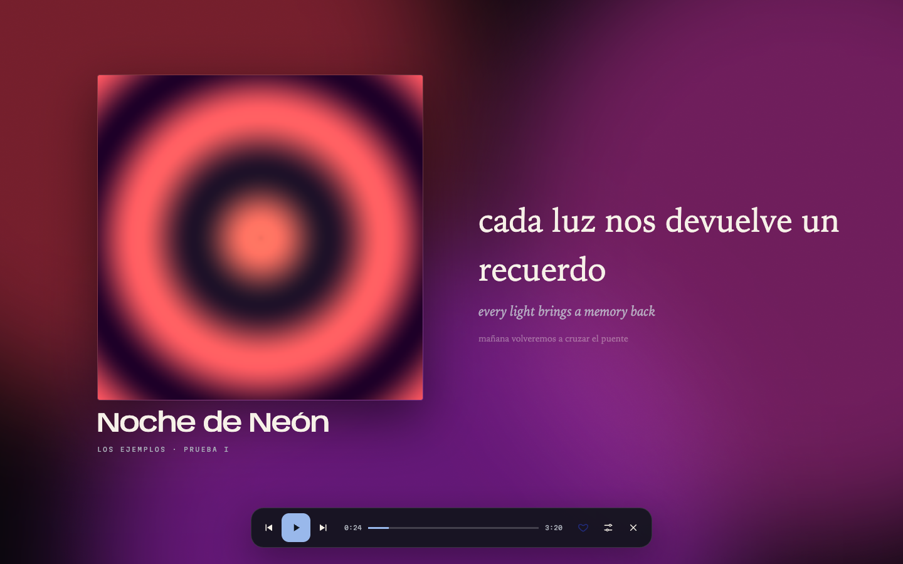
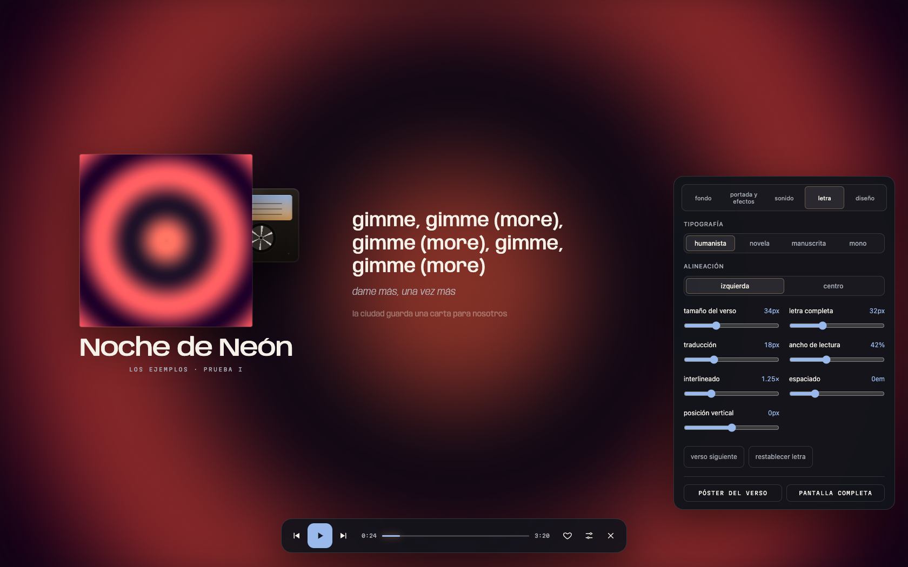
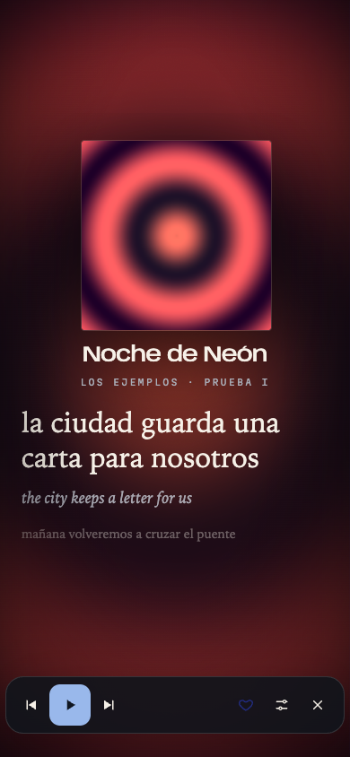

# modo carátula

carátula conserva su propio tema para que fábula y risografía no sobrescriban sus superficies. en ventanas amplias, las opciones reservan espacio junto a la vista previa.

abre la carátula y entra al menú del reproductor:

- **portada y efectos:** s/m/l cambian el tamaño en las tres composiciones, con las opciones abiertas o cerradas; el tamaño se conserva también al exportar.
- **letra:** cuatro familias tipográficas, alineación, tamaño del verso, letra completa y traducción; ancho, interlineado, espaciado, posición vertical y verso siguiente.
- **diseño:** composiciones editorial, centrada e inmersiva; sesiones preparadas para lectura o escucha nocturna, concentración y un estilo personal guardado en esta mac.
- **sonido:** conserva los efectos de audio disponibles en lumora.

la letra completa permite saltar al verso con clic o teclado, respetando el desfase de sincronización. se actualizan traducciones y correcciones aunque el número de versos no cambie. el reloj de las letras funciona independientemente del motor visual anterior.

«guardar escena» descarga una composición limpia en png de 1920 × 1080. las grabaciones hechas con carátula abierta usan esta composición, su tipografía y traducción. la exportación muestra el verso actual; los adornos animados de vinilo, cd y otros fondos no se reproducen en ella.

las preferencias se conservan al reiniciar. el movimiento reducido respeta tanto macos como el ajuste de lumora. el diseño se adapta a ventanas estrechas.

validación: `tools/test_cover_design.mjs` cubre ajustes, persistencia, estilo personal, teclado, salto al verso, png, exportación, móvil y movimiento reducido; `tools/test_cover.mjs` cubre las funciones existentes.

`tools/test_cover_layout.mjs` cubre 432 combinaciones de ambos temas, tres composiciones, cuatro fondos, tres tamaños, tres ventanas y letra en línea o completa; verifica recortes y solapamientos de la portada y sus adornos, legibilidad del menú y teclado.

`tools/test_cover_controls.mjs` pulsa s/m/l y comprueba diferencias reales de ancho, persistencia, fondos, efectos, ancho de lectura móvil, concentración, exportación y navegación con desfase.
