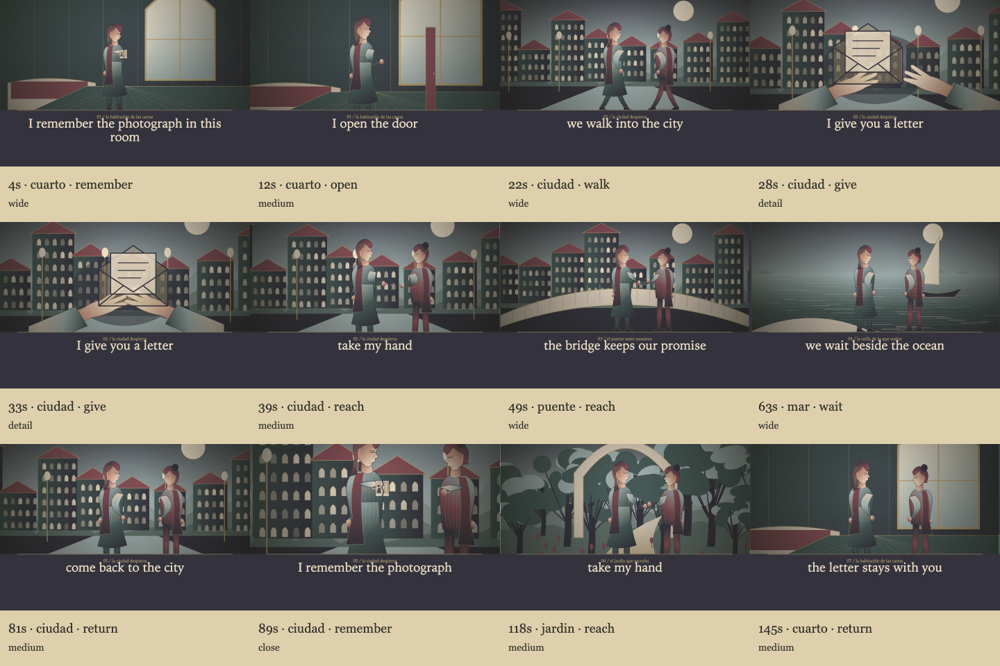

# motor de fábula

fábula tiene su propio renderizador canvas. comparte datos con el director y el catálogo de lumora, sin pasar por las planchas, las tramas o los sellos de risografía.

- escenarios compuestos por capas, con arquitectura, vegetación y utilería. algunos pertenecen a una misma familia visual, con elementos específicos para distinguirlos.
- tomas durante toda la duración, incluso sin letra, con cadencia relacionada con el tempo. los versos y las secciones dirigen el recorrido; un escenario permanece entre planos y conserva su composición al regresar.
- estribillos que recuperan motivos entre otras escenas del recorrido.
- planos generales, medios, primeros planos, detalles y contraplanos.
- personajes con proporciones adultas, rostro en tres cuartos, ropa con volumen, brazos articulados y expresiones. perfiles conocidos del catálogo, acompañantes y accesorios. los artistas desconocidos usan un avatar estable; no se promete parecido real.
- acciones con comienzo y final: caminar, acercarse, entregar una carta y recordar. los objetos narrativos aparecen en manos o en planos de detalle. la carta cambia de dueño; buscar hacia atrás reconstruye su estado. correcciones manuales, clima y movimiento sensible al nivel de audio disponible.
- cámara, intensidad, categorías, frecuencia del catálogo y movimiento reducido respetados.
- exportación con el mismo guion; la reproducción reserva espacio para las letras sobre el reproductor.

la selección narrativa usa reglas locales y estructura estimada de la canción. las ilustraciones son procedurales: no son imágenes generadas por verso. los tratamientos exclusivos de risografía conservan su propia opción.

validación: `tools/test_fabula.mjs` comprueba reproducción, exportación, independencia, ajustes y persistencia. `tools/test_fabula_engine.mjs` recorre todos los dibujos y escenarios, prueba instrumentales, letras repetitivas, correcciones manuales, búsqueda determinista y escala retina.

`tools/test_fabula_story.mjs` verifica una secuencia narrativa completa, entrega de objetos, regreso al mismo escenario, búsqueda y movimiento reducido. la apariencia sigue siendo ilustración vectorial procedural; no equivale a animación cinematográfica pintada a mano.
