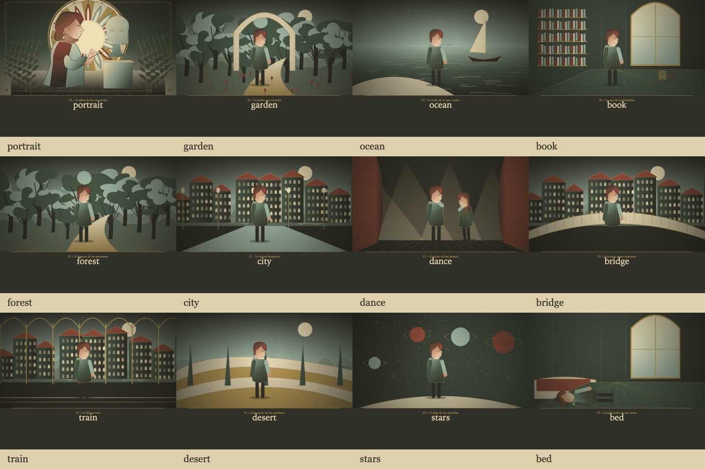

# motor de fábula

fábula tiene su propio renderizador canvas. comparte datos con el director y el catálogo de lumora, sin pasar por las planchas, las tramas o los sellos de risografía.

- escenarios compuestos por capas, con arquitectura, vegetación y utilería. algunos pertenecen a una misma familia visual, con elementos específicos para distinguirlos.
- tomas automáticas durante toda la duración, incluso sin letra. los versos pueden introducir un lugar, una acción o un objeto antes del siguiente corte automático.
- estribillos que recuperan motivos entre otras escenas del recorrido.
- planos generales, medios, primeros planos, detalles y contraplanos.
- personajes articulados, perfiles conocidos del catálogo, acompañantes y accesorios. los artistas desconocidos usan un avatar estable; no se promete parecido real.
- acciones del director, correcciones manuales, estados de objetos, clima y movimiento sensible al nivel de audio disponible.
- cámara, intensidad, categorías, frecuencia del catálogo y movimiento reducido respetados.
- exportación con el mismo guion; la reproducción reserva espacio para las letras sobre el reproductor.

la selección narrativa usa reglas locales y estructura estimada de la canción. las ilustraciones son procedurales: no son imágenes generadas por verso. los tratamientos exclusivos de risografía conservan su propia opción.

validación: `tools/test_fabula.mjs` comprueba reproducción, exportación, independencia, ajustes y persistencia. `tools/test_fabula_engine.mjs` recorre todos los dibujos y escenarios, prueba instrumentales, letras repetitivas, correcciones manuales, búsqueda determinista y escala retina.
