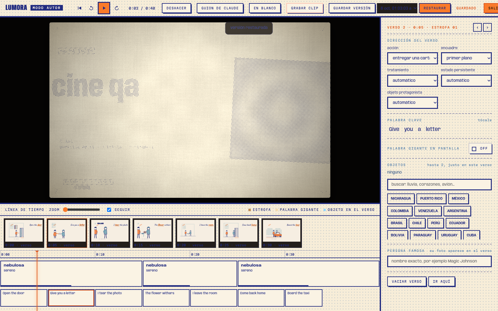

# dirección cinematográfica · 8 de octubre de 2026

- acciones con preparación, ejecución y cierre: abrir puerta, entregar carta, subir al taxi, marcharse, regresar, caminar, recordar y renacer. foto y flor cambian de estado; la habitación conserva la ausencia hasta el regreso.
- el estado se reconstruye desde la letra y el tiempo de canción. adelantar, retroceder o repetir no depende del orden en que se dibujaron los cuadros.
- planos general, medio, primer plano, detalle y contraplano. el encuadre afecta la ilustración y conserva la zona de lectura de la letra.
- estructura estimada mediante repeticiones y energía del guion: introducción, verso, coro, puente, clímax y cierre. no constituye análisis acústico. el editor permite corregirla; puente y clímax modifican la intensidad de los cortes.
- 80 perfiles de artistas. incorporados los integrantes de queen, nirvana y the beatles; twenty one pilots aparece como dúo. instrumentos procedurales de guitarra, bajo, ukelele, batería y teclado. variantes de vestuario para álbumes concretos de tyler, josh, freddie y the beatles. son ilustraciones estilizadas, no reconstrucciones fotográficas ni identificación de voces reales.
- modo autor (`e`): fotogramas del motor real en la línea de tiempo; acción, encuadre, tratamiento, objeto y estado por verso; función musical por sección. miniaturas diferidas fuera del área visible.
- guardado automático por canción en indexeddb y puente; en la web el puente conserva el proyecto localmente. hasta 30 versiones por canción, restaurables y compatibles con deshacer. se rechaza restaurar una versión cuya letra o tiempos hayan cambiado.
- acceso por teclado, foco visible, retorno del foco al cerrar, fondo inerte y anuncios de guardado/restauración. no cambia la licencia.

## comprobación

`tools/test_cine.mjs`: estados acumulados, acciones, negación, búsquedas deterministas, estructura y correcciones.

`tools/test_cine_editor.mjs`: edición real, miniaturas, guardado, restauración, persistencia tras recargar y aislamiento entre canciones.

`tools/test_relato_render.mjs`: render de los 80 perfiles y la secuencia narrativa, más integración con el clip.

captura real del editor:

## referencias visuales

vestuario de clancy: [portada oficial](https://store.twentyonepilots.com/products/clancy-digital-album?variant=47883145478463). instrumentación de josh: [sjc, batería de la gira clancy](https://www.sjcdrums.com/blogs/blog/josh-dun-twenty-one-pilots-clancy-world-tour-drum-kit). no se incluyen fotografías externas en el render procedural.

validación final: ejecutada la batería completa de `tools/check.sh` con playwright y las 8 pruebas python. la primera pasada detectó dos supuestos antiguos en pruebas (el zoom conservado del atlas y la lista de tipos de toma de la mezcla); corregidos y repetidos atlas, mezcla, editor y render, todos correctos. smoke, 753 objetos, ajustes, geometría, grief, letra, colección, almacenamiento y visor también correctos. comprobado además el guardado del puente web después de recargar. ninguna omisión de pruebas de navegador en esa pasada.
