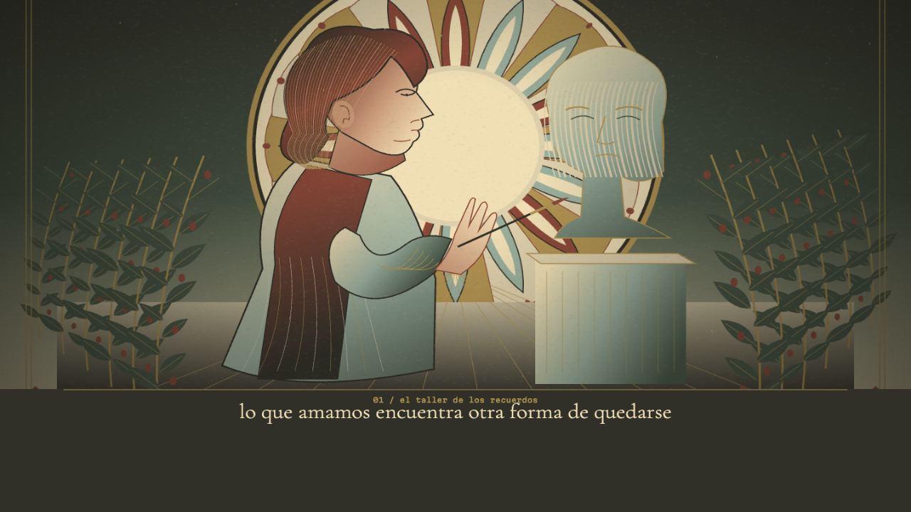

# cuento ilustrado

se activa en ajustes > estilo del video > cuento ilustrado, o aplicando su look. no reemplaza la risografía. interpretación procedural de la referencia: papel cálido, rojos arcilla, verdes apagados, medallón ornamental y una figura de perfil pintando un busto.

el módulo `js/riso/riso-cuento.js` dibuja todo con canvas: no usa la foto adjunta, imágenes generadas, servicios ni vídeos de fondo. mantiene la paleta, el protagonista y la textura por canción y semilla. las palabras de la letra en español e inglés cambian entre taller, jardín, mar y torre; los versos sin lugar explícito conservan el capítulo. el ánimo elige flor, estrella o polilla. es una gramática visual local, sin comprensión narrativa de idiomas adicionales.

el reloj de reproducción controla cámara, respiración, antebrazo y partículas. pausa y búsqueda no acumulan animación independiente. movimiento reducido inmoviliza esos elementos y elimina los fundidos. los fondos y la textura se preparan una vez; la caché guarda como máximo dos páginas. los cambios de capítulo funden durante 1.8 segundos.

`tools/test_cuento.mjs` verifica capítulos, continuidad, semillas, render determinista, límite de caché, selección con enter, persistencia e integración con `RISOCLIP.frame`. genera capturas reales de escritorio y móvil en `/tmp/lumora-cuento-desktop.png` y `/tmp/lumora-cuento-mobile.png`.

revisión visual realizada en 1280×720 y 390×844. la fuente, la distribución web y los módulos dentro de lumora.app coinciden byte por byte. dmg reconstruido (130.9 mb), con verificación de mínimos macos y firma local aprobadas.

suite completa con playwright: 29 archivos de pruebas, sintaxis y smoke aprobados sin omisiones (`CHECK: ok`). el checksum del dmg también pasa `hdiutil verify`.

el estilo conserva letras originales, traducción y tamaño configurado. se dibuja sobre el mismo lienzo que capturan vídeo y recuerdo. la captura de audio nativa mantiene las limitaciones documentadas en la revisión anterior; este cambio no las resuelve.
