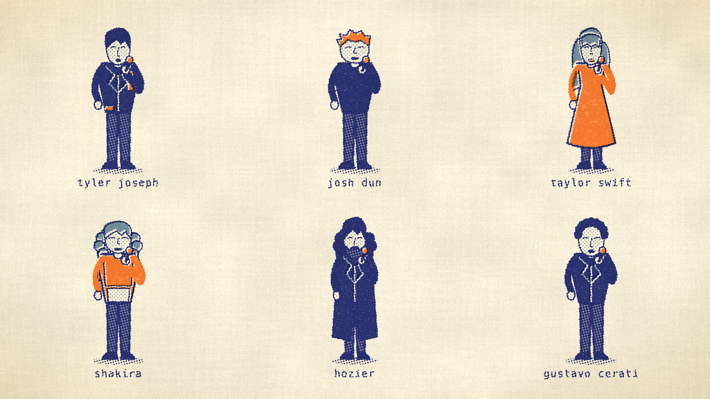
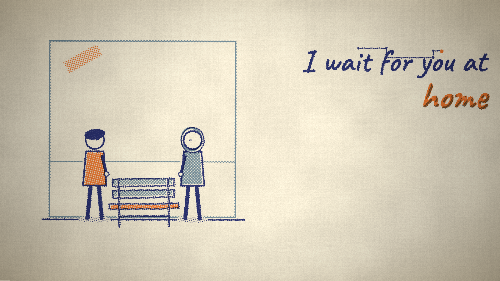

# continuidad visual y retratos

- 71 perfiles de artistas: 15 incorporaciones; proporciones faciales diferenciadas en 24 perfiles, complexión, cabello y vestuario por álbum para twenty one pilots y billie eilish. son ilustraciones estilizadas; no retratos fotorrealistas.
- 12 dibujos nuevos: carta, maleta, puerta, ventana, foto, banco, hilo, puente, escalera, faro, brote y silla. las variantes de objetos existentes comparten grupo para evitar duplicados.
- guion local bilingüe compilado desde la letra completa: partida, regreso, espera, encuentro, caminata, recuerdo y renacimiento. mantiene escenario, reparto y símbolo; el estribillo recupera su composición y color. las negaciones cubiertas no consuman la acción negada.
- las tomas narrativas sitúan objetos junto a los actores. las escenas pedidas por el guion mantienen prioridad y ya no cambian solo para añadir variedad. el director opcional recibe los nuevos objetos y reglas de continuidad; la versión de su caché pasa a g5.
- geometría y grief mantienen su ruta especializada. la licencia permanece igual.

## validación

- `tools/test_relato.mjs`: continuidad, estribillos, negaciones, cambios de letra y determinismo de la composición.
- `tools/test_artistas_geometry.mjs`: aliases, colaboraciones, rasgos, vestuario sin mutación del perfil base y los 22 niveles existentes.
- `tools/test_relato_render.mjs` con playwright: render de los 71 perfiles, 12 recursos, escenas narrativas y conexión con el clip real; sin errores de página.
- `tools/test_cantantes.mjs` con playwright: solos, colaboraciones, personajes desconocidos, figura de the weeknd y ajuste para ocultar cantantes.
- `tools/test_props.mjs` con playwright: 753 dibujos, sin excepciones, límites de encuadre, trazos completos, etiquetas y menos de 900 puntos por dibujo.
- `tools/check.sh`: sintaxis y pruebas de node; su detección automática omite navegador si no se indica la ruta de playwright. las pruebas de navegador citadas arriba se ejecutaron por separado con el runtime disponible.
- `tools/smoke.mjs` y `tools/test_geometry_clip.mjs` con playwright: arranque del videoclip narrativo, 80 variantes, búsquedas en el tiempo, modos y salida normal sin errores.
- `python3 -m unittest discover -s tests -v`: 8 pruebas aprobadas; `guion.py` compila.

las capturas son renders reales del canvas. el guion local usa reglas y contexto, por lo que no interpreta todas las metáforas o negaciones posibles. no se afirma una mejora fotorrealista ni se ha medido rendimiento en todos los dispositivos.

